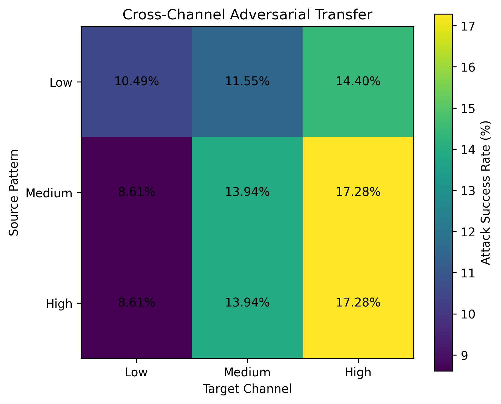
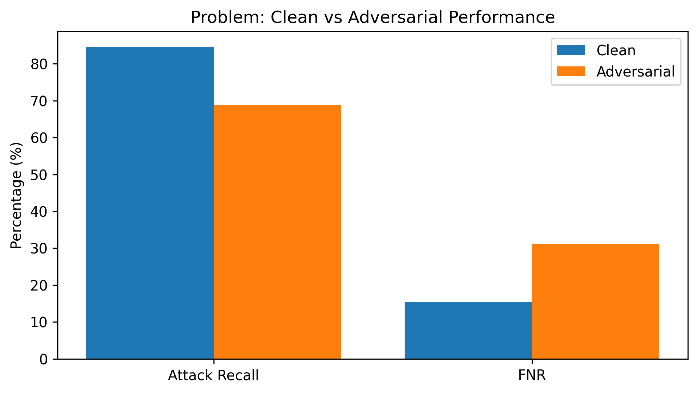
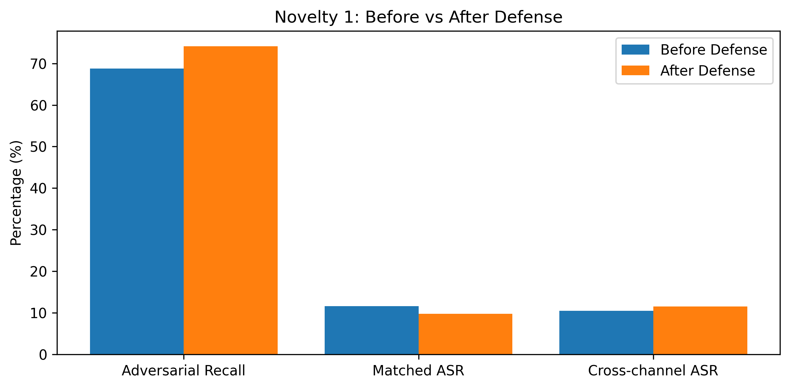
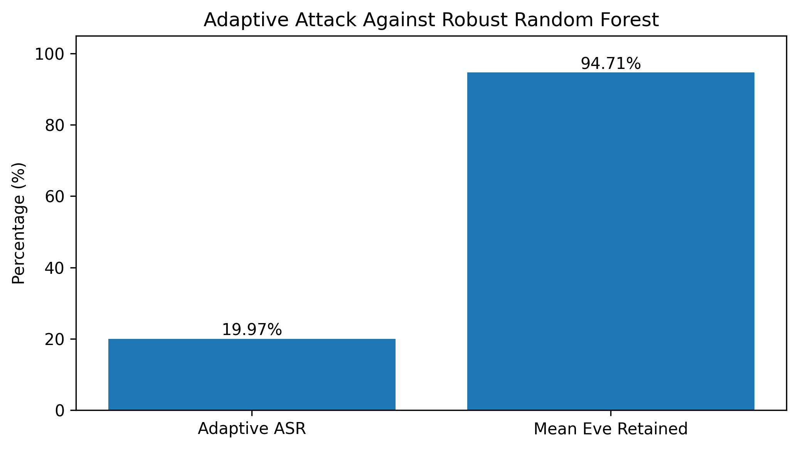

# Cross-Channel Adversarial Transfer and Adaptive Robustness of ML-Based BB84 QKD Attack Detection

Code, data, configurations and results for a study of how a machine-learning attack detector for BB84 quantum key distribution (QKD) can itself be attacked, and whether adversarial strategies transfer across channel conditions.



## Overview

Machine-learning monitoring can strengthen practical QKD, but the detector itself becomes an attack surface. This project:

1. Simulates BB84 sessions under **Low**, **Medium** and **High** noise/loss channel regimes and extracts eight physics-informed telemetry features.
2. Trains a **Random Forest** attack detector, threshold-tuned on validation data for maximum attack recall at a false-positive rate of at most 20%.
3. Builds **simulator-consistent adversarial examples**: physical parameters (interception strength, noise, loss) are changed within channel bounds and the same session is re-simulated with its original seed. Telemetry is never edited directly.
4. Measures **cross-channel transfer**: does an attack recipe chosen in one channel still evade the detector in another?
5. Evaluates a **channel-diverse adversarial-training defense**, then attacks the defended model directly (**adaptive attack**).

## Key results

| Experiment | Metric | Result |
|---|---|---|
| Clean test | Baseline RF attack recall | 84.56% |
| Physical adversarial attack | Baseline RF attack recall | 68.78% (ASR 18.66%) |
| Fresh 1,800-session confirmatory set | Baseline recall, clean → adversarial | 85.56% → 69.78% (ASR 18.44%) |
| Cross-channel transfer | Low → High ASR | 14.40% |
| Defense (non-adaptive), fresh set | Adversarial recall, baseline → robust | 69.78% → 76.56% |
| Adaptive attack on robust RF | ASR / robust recall | 19.97% / 68.11% |
| Ten independent seeds (clean) | Recall, baseline / robust | 84.49 ± 1.27% / 83.81 ± 0.96% |

**Main finding:** adversarial recipes transfer across channel conditions, and simple adversarial augmentation gives only partial protection against an adaptive attacker.

| Clean vs adversarial | Defense before vs after | Adaptive attack |
|---|---|---|
|  |  |  |

## Repository structure

```
QKD-Project/
├── notebooks/
│   ├── quick_verification.ipynb               # reproduces every headline number in ~1 minute
│   └── adversarial_bb84_qkd_detection.ipynb   # full experiment pipeline (long run)
├── data/                                      # train / validation / test / adversarial / fresh confirmatory CSVs
├── configs/                                   # frozen thresholds, adversarial and validation protocols, SHA-256 hash
├── models/                                    # BB84 simulator (+ trained RF models, see below)
├── results/                                   # all numerical results (cross-channel, defense, fresh, multi-seed, adaptive)
├── figures/                                   # all paper figures
├── requirements.txt
└── LICENSE
```

## Getting started

```bash
git clone https://github.com/arifex/QKD-Project.git
cd QKD-Project
pip install -r requirements.txt
```

### Trained models

The two trained Random Forest models are too large for the main repository. Download them from the **[Releases](../../releases)** page and place them in `models/`:

- `random_forest_v2_primary.joblib` (baseline detector, threshold 0.38)
- `random_forest_v2_robust_unthresholded.joblib` (robust detector, threshold 0.59)

### Run

**Quick verification (recommended first).** Open `notebooks/quick_verification.ipynb` and run all cells. It loads the frozen models, data and saved results and re-checks the simulator sanity test, clean performance, adversarial ASR, the cross-channel matrix, the defense, the fresh confirmatory set, ten-seed stability and the adaptive attack, without re-running the heavy experiments.

**Full pipeline.** `notebooks/adversarial_bb84_qkd_detection.ipynb` regenerates the datasets, models and results from scratch. The adversarial searches take several hours.

Both notebooks set the project path in their first cell: locally they use the repository root (run them from the `notebooks/` folder); in Google Colab they mount Google Drive and use `MyDrive/Adversarial_QKD_Attack`, so copy the repository folders there first.

## Reproducibility

- Fixed seeds: model seed `20261004`; fresh confirmatory master seed `20261021`.
- Thresholds were selected on validation data only; test results were never used for tuning.
- The fresh confirmatory CSV is fixed by a SHA-256 hash (`configs/paper_v3_fresh_confirmatory_test_sha256.txt`).
- Environment: Python 3, NumPy, pandas, scikit-learn 1.6.1 (see `requirements.txt`).

## Limitations

Simulation-based study (independent bit-flip noise, Bernoulli loss, partial intercept-resend attacks); not a hardware security proof. See the paper for the full discussion.

## Citation

If you use this code or data, please cite the accompanying paper (citation will be added on publication).

## License

Released under the MIT License. See [LICENSE](LICENSE).
